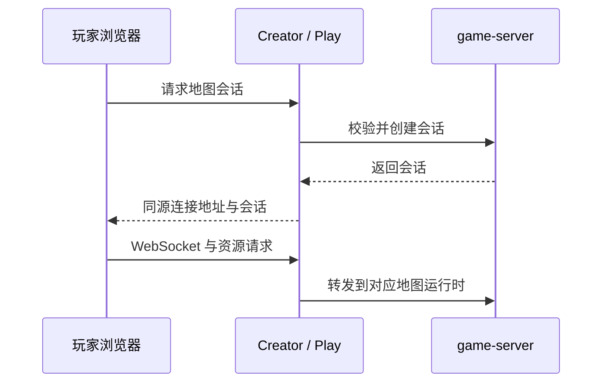

# 权威游戏运行时

`services/game-server` 维护实体、体素、会话、地图脚本、storage 和反作弊。它由 Creator / Play 管理，不是玩家直接部署的网页服务。

| 模式        | 行为                                        |
| ----------- | ------------------------------------------- |
| 编辑        | 保存工程变化，供 Creator 使用               |
| 预览 / 游玩 | 执行脚本与权威状态；Play 加载不可变发布快照 |

## 调试与检查

日常调试从根目录 `npm run dev:infra` 启动，让本地引擎提供工程、资源、身份和内部配置。

高级独立调试可用 `npm --prefix services/game-server run dev`，但应先设置 `STORAGE_PATH` 指向独立测试工程/资源目录，以及需要的 `BOX_PROJECT_STATE_PATH` / `HASH`。`MODE=edit` 选择编辑模式；该入口默认使用本地配置，内部端口为 play `9966`、edit `9967`，调试器 `9223`。不要使用真实作品目录做破坏性测试。

| 按需任务     | 根目录命令                                                  |
| ------------ | ----------------------------------------------------------- |
| 构建         | `npm --prefix services/game-server run build`               |
| 运行时回归   | `npm --prefix services/game-server test`                    |
| 反作弊       | `npm --prefix services/game-server run check:anticheat`     |
| 本地 storage | `npm --prefix services/game-server run check:local-storage` |
| 会话撤销     | `npm --prefix services/game-server run check:realtime`      |

## 接口边界

- 健康检查为 `/api/health-check`；资源读取为 `/block/:hash`。
- Play 资源存储只读，`POST /block` 返回 403。
- `/api/session`、`/api/server-info` 为兼容直连接口，仅在显式设置 `BOX_DIRECT_SESSION_API=true` 时开放。
- 玩家浏览器必须下载场景可见资源；秘密、授权与重要业务逻辑保留在服务端。

运行地址和密钥由启动器注入，内部控制端口不直接公开。源码配置和数据位置见[开发入门](../../docs/developer-guide.md)，测试边界见[检查与测试](../../docs/testing.md)。
