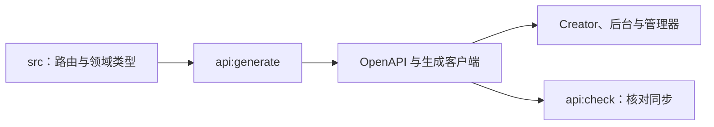

# HTTP API 契约与客户端

`@box/apis` 统一路由、领域类型、权限元数据、OpenAPI 和生成客户端。地图脚本声明由 `internals/schema` / `packages/script-api` 维护。



| 位置                                                  | 内容            |
| ----------------------------------------------------- | --------------- |
| `src/routes.ts`、`domain.ts`、`local-engine-types.ts` | 契约源          |
| `src/permissions.ts`                                  | 权限元数据      |
| `scripts/generate-openapi.mjs`、`generate-client.mjs` | 生成工具        |
| `openapi/openapi.json`、`src/generated/`              | 需提交的生成物  |
| `test/`、`dist/`                                      | 回归 / 构建结果 |

根目录安装依赖后，修改契约并按需执行：

```sh
npm run api:generate
npm run api:check
npm run api:build
npm --prefix internals/apis test
```

`npm run api:docs` 启动本机参考文档，地址以日志为准。不要手改生成客户端；字段、方法、响应和鉴权需同时核对服务实现。契约检查不属于基础 Verify。
